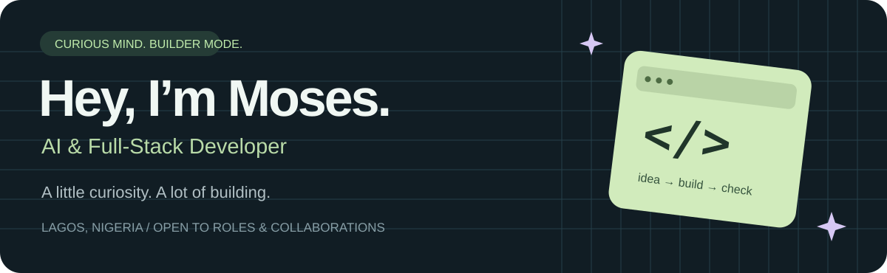
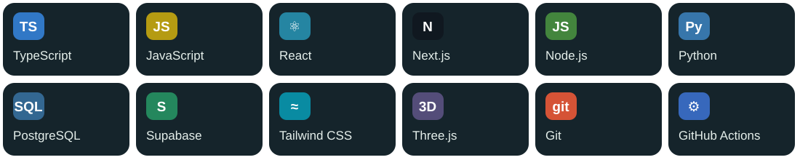

  
  

🤖 Useful AI &nbsp; · &nbsp; 🧩 Thoughtful interfaces &nbsp; · &nbsp; ⚙️ Practical automation

I’m a developer in **Lagos, Nigeria**, with frontend roots and a growing collection of AI and full-stack projects. I like the part where a messy idea becomes something you can actually try.

- 🛠️ **Building:** AI application workflows, web products, and small automations that do a useful job.
- 🔍 **My approach:** clear UX, independent checks, and results you can inspect.
- 🤝 **Open to:** developer roles and collaborations.

### 🧰 The toolbox

  

**AI work:** model APIs · structured outputs · agent workflows · human approval gates 
**Tools I use:** Codex · Claude API · Gemini API

### 🧪 A few things from my workbench

<table>
<tr>
<td width="50%" valign="top">
<h3>🛠️ ReleaseRoom</h3>

An AI prepares a patch. Independent checks verify it. A human approves the exact hash before handoff.

<a href="https://github.com/mosesfawole/releaseroom">Code & notes</a> · <a href="https://youtu.be/CgD3kSIa8W0">Watch demo</a>

</td>
<td width="50%" valign="top">
<h3>🛍️ ClearCart</h3>

AI-assisted shopping with checked budgets, buyer approval, and verified PayPal sandbox receipts.

<a href="https://github.com/mosesfawole/clearcart">Code & notes</a> · <a href="https://www.youtube.com/watch?v=slJc7aeOWz8">Watch demo</a>

</td>
</tr>
<tr>
<td width="50%" valign="top">
<h3>🔬 NEAR Replay Lab</h3>

Replay payment failure scenarios and inspect what finalized testnet evidence actually proves.

<a href="https://github.com/mosesfawole/near-replay-lab">Code & evidence</a>

</td>
<td width="50%" valign="top">
<h3>📡 Teletext Venue Bulletin</h3>

A local Wi-Fi event bulletin. Staff change the room; late arrivals get the current revision.

<a href="https://github.com/mosesfawole/teletext-venue-bulletin">Explore the prototype</a>

</td>
</tr>
<tr>
<td width="50%" valign="top">
<h3>🛰️ Claude Pass Radar</h3>

Scheduled public-source scans, deduplicated Telegram alerts, and controls for a free search budget.

<a href="https://github.com/mosesfawole/claude-referral-monitor">See the automation</a>

</td>
<td width="50%" valign="top">
<h3>🏴‍☠️ Baroque Works</h3>

A One Piece fan experience with 3D characters and scroll storytelling. My playful side of the web.

<a href="https://github.com/mosesfawole/baroque">Source</a> · <a href="https://baroque-theta.vercel.app/">Explore website</a>

</td>
</tr>
</table>

<b>🧠 A note on how I build</b>

 
I use AI-assisted development. Project READMEs distinguish what is real, simulated, tested, and still a prototype. ClearCart uses fictional products and sandbox funds; NEAR Replay Lab uses constructed testnet fixtures. The pass monitor does not use a language model, and finding a link does not guarantee redemption.

### 🌱 More from the shelf

[🏡 Homeland](https://github.com/mosesfawole/homeland) · [💼 HireBoard](https://github.com/mosesfawole/hireboard) · [✨ KipClean](https://github.com/mosesfawole/kipclean-v1)

---

<b>Got a good problem? Let’s build something useful.</b> <a href="mailto:mosesfawoleh@gmail.com">mosesfawoleh@gmail.com</a>

